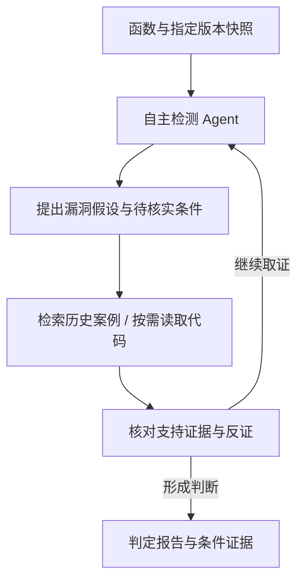

# func-vuln-agent

**面向 C/C++ 单函数的漏洞检测 Agent：从历史漏洞中提取成立条件，按需查找代码证据，并检查能够推翻初步判断的安全条件。**

> 后端合成联调阶段 · 高级软件工程课程项目

[开发任务](https://github.com/Ars1027/func-vuln-agent/issues) · [检测方法](docs/method.md) · [接口约定](docs/interfaces.md) · [团队分工](docs/team.md) · [AI 提示词](docs/prompts/README.md)

## 项目思路

项目的交互形式受 Codex GitHub Review 和 Sourcery Bot 启发。Web 页面用于输入函数、查看分析过程和批量结果；GitHub Bot 用于触发检测并回复报告。

检测方法围绕“漏洞成立需要哪些条件”展开。例如，遇到 `memcpy(dst, src, len)`，Agent 会查找目标缓冲区容量、长度来源和调用路径上的边界检查，再判断是否存在越界。历史案例提供检索线索，待测版本中的代码提供判断证据。

检测内核在课程要求的 RAG 和按需仓库读取接口上，加入了**条件驱动的证据补全与反证检查**。真实模块接入后的效果由对照实验检验，当前尚无课程评测结果。

## 检测流程



报告显示每项条件的状态：**有支持证据、有反证、待确认**，并链接到历史案例或代码位置。[检测方法](docs/method.md)说明判断方式与实验设计。

## 使用入口与运行方式

- **Web**：输入函数和修复提交链接，选择该提交或父提交；支持上传课程 JSONL，实时查看检索与读取记录，下载结果。
- **GitHub Bot**：在课程闭环完成后接入，按显式提交、文件和函数触发同一检测服务。
- **运行**：先在本地完成开发和演示；需要持续在线访问时，再部署到 Linux 云服务器。

技术路线为 **Python + LangGraph + FastAPI + React/TypeScript**，过程事件通过 SSE 推送。当前已提供后端自主检测循环、任务与事件 API，以及无需课程数据或模型密钥的合成联调入口：

```sh
uv sync --locked
uv run uvicorn app.demo:build_app --factory --app-dir backend --host 127.0.0.1 --port 8000
```

打开 `http://127.0.0.1:8000/docs`，或上传 `examples/synthetic.jsonl` 测试批量流程。演示使用脚本模型与人工合成材料，不代表真实检测效果。实际 RAG、快照、课程导出和 Web 待各模块接入，运行配置及接口交接见[后端联调说明](docs/backend.md)。

## 团队与任务

每个 issue 由一人负责实现、验证和文档。

| 成员 | 职责 | Issues |
| --- | --- | --- |
| 陈子星（组长，`Ars1027`） | 接口、条件驱动 Agent、检测 API、集成验收 | [#1](https://github.com/Ars1027/func-vuln-agent/issues/1)、[#5](https://github.com/Ars1027/func-vuln-agent/issues/5) |
| 安晟毅 | 历史案例整理、成立条件与安全条件提取、RAG | [#2](https://github.com/Ars1027/func-vuln-agent/issues/2) |
| 臧天心 | 版本快照、代码上下文与证据定位工具 | [#3](https://github.com/Ars1027/func-vuln-agent/issues/3)、[#4](https://github.com/Ars1027/func-vuln-agent/issues/4) |
| 周德铭 | Web 输入、过程展示、条件证据报告 | [#6](https://github.com/Ars1027/func-vuln-agent/issues/6) |
| 史鹏飞 | 课程评测、方法对照实验、GitHub Bot | [#7](https://github.com/Ars1027/func-vuln-agent/issues/7)、[#8](https://github.com/Ars1027/func-vuln-agent/issues/8) |

[四个里程碑](https://github.com/Ars1027/func-vuln-agent/milestones)：接口与数据准备、单函数检测闭环、批量评测、GitHub Bot。#1 先交付接口检查点，在 M3 完成集成验收。

## 课程要求与协作

课程要求历史知识库仅使用提供的数据，待测函数严格单版本隔离，模型不接触标签、diff 或网络搜索。成功检测按课程格式导出 `idx` 和 `prediction`。

- [课程要求与评分](docs/course-requirements.md)
- [架构与数据流](docs/architecture.md)
- [AI 编码约定](AGENTS.md)
- [分支与 PR 协作](CONTRIBUTING.md)
