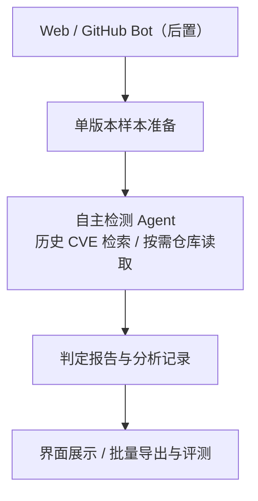

# func-vuln-agent

**面向 C/C++ 单函数的漏洞检测 Agent。** 检索课程提供的历史 CVE 案例，按证据需要读取指定版本的代码上下文，输出可追溯的判定报告。

> **设计阶段** · 高级软件工程课程小组项目 · 当前仓库包含设计与协作文档，检测程序尚未实现。

[开发任务](https://github.com/Ars1027/func-vuln-agent/issues) · [课程要求](docs/course-requirements.md) · [模块接口](docs/interfaces.md) · [五人分工](docs/team.md) · [AI 任务提示词](docs/prompts/README.md)

## 计划中的检测体验

在 Web 页面输入一个函数和修复提交链接，明确选择函数所在的该提交或父提交版本；也可上传课程 `.jsonl` 样本。页面显示历史案例检索和代码读取记录，完成后展示有漏洞 / 无漏洞的判断、理由与证据。批量结果可导出为课程要求的 `result.jsonl`。

GitHub Bot 在课程检测闭环完成后接入同一服务，在 GitHub 上触发检测、回复报告。检测时只读取指定版本的函数及上下文。

## 系统关系

模型根据已有证据决定查什么、是否继续读取代码、何时结束分析。检索与仓库读取属于工具调用，记录同步展示在界面中。[架构与数据流](docs/architecture.md)说明各模块的责任和交接。

## 五人分工

每个任务只有一位负责人。成员账号确认后再设置 GitHub assignee。

| 负责人 | 独立负责的模块 | Issues |
| --- | --- | --- |
| 组长 `Ars1027` | 接口、Agent、检测 API、集成验收 | [#1](https://github.com/Ars1027/func-vuln-agent/issues/1)、[#5](https://github.com/Ars1027/func-vuln-agent/issues/5) |
| 成员 A | 历史 CVE 数据与 RAG | [#2](https://github.com/Ars1027/func-vuln-agent/issues/2) |
| 成员 B | 样本与仓库版本、代码上下文工具 | [#3](https://github.com/Ars1027/func-vuln-agent/issues/3)、[#4](https://github.com/Ars1027/func-vuln-agent/issues/4) |
| 成员 C | Web 输入、过程展示、报告与下载 | [#6](https://github.com/Ars1027/func-vuln-agent/issues/6) |
| 成员 D | 批量评测、GitHub Bot | [#7](https://github.com/Ars1027/func-vuln-agent/issues/7)、[#8](https://github.com/Ars1027/func-vuln-agent/issues/8) |

跨模块问题交回对应负责人处理，接口变更由组长协调。[协作指南](CONTRIBUTING.md)约定分支、PR 与合并流程。

## 开发阶段

| 里程碑 | 交付目标 | 任务 |
| --- | --- | --- |
| M1 · 接口与数据准备 | 接口基线、课程数据确认、RAG 与指定快照准备 | #1 的接口检查点、#2、#3 |
| M2 · 单函数检测闭环 | 自主工具调用、API、实时 Web 报告 | #4、#5、#6 |
| M3 · 批量评测 | 300 条结果、成对指标、完整导出、集成验收 | #7、#1 的最终验收 |
| M4 · GitHub Bot | GitHub 触发与报告回复 | #8 |

组长先完成 #1 的接口检查点，各成员随后按约定独立开发。#1 保持开启直到最终集成验收；其 GitHub milestone 为 M3。里程碑不设置日期。

## 技术路线

| 部分 | 已选路线 |
| --- | --- |
| Agent 与后端 | Python、LangGraph、FastAPI |
| Web 前端 | React、TypeScript |
| 过程展示 | Server-Sent Events（SSE） |
| 历史案例检索 | RAG；索引与嵌入方案由 #2 在课程约束内确定 |
| 仓库工具 | 指定提交快照、代码搜索与读取，按需使用语法解析 |

课程数据尚未取得。真实字段、模型配置和运行方式在对应实现任务中确定并更新文档。当前没有可运行应用或安装步骤。

## 课程边界

- 知识库只使用课程提供的历史案例，历史漏洞版与修复版允许成对使用。
- 每次检测一个版本。测试漏洞样本读取父提交，修复样本读取修复提交后的仓库。
- 标签、另一个版本和代码 diff 不进入模型输入，也不能通过工具访问。
- 检测系统不配置网络搜索工具，不通过额外安全知识或联网答案补充 RAG。
- 检测内核自行实现自主 Agent。开发者可以使用 AI 辅助编码。

完整要求与评分规则见[课程要求](docs/course-requirements.md)。

## 开始协作

1. 阅读自己的 issue 和[角色提示词](docs/prompts/README.md)。
2. 阅读 [AGENTS.md](AGENTS.md)、[接口约定](docs/interfaces.md)与[协作指南](CONTRIBUTING.md)。
3. 根据前置任务状态，交付自己的模块及验证记录，通过 PR 交给组长合并。

初始仓库不包含课程数据、仓库快照、密钥或评测结果；这些内容保存在本地。
